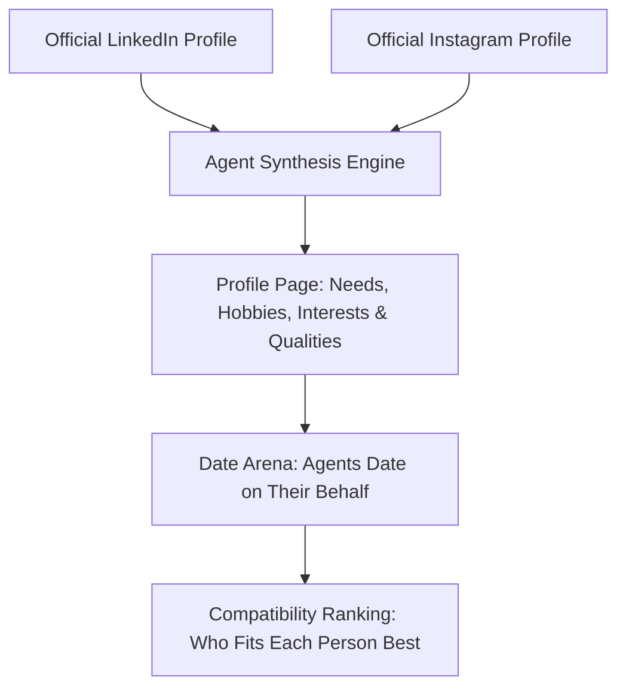

# ✨ Synthetica Cupid — Autonomous Agentic Dating Platform

> An agentic dating platform where AI agents represent real people based strictly on their official LinkedIn and Instagram profiles, date each other in real-time, and compute mutual compatibility rankings.

---

## 🌟 The Main Idea
Each person is represented by an autonomous agent. That agent dates on that person's behalf. The agents date each other.

### The Two Information Sources:
For every person and every agent, there are **exactly two sources of truth**:
1. **LinkedIn Public Profile**: Extracts career ethos, professional ambition, leadership style, and intellectual focus.
2. **Instagram Public Profile**: Extracts aesthetic vibe, travel footprint, weekend rituals, and culinary/cultural taste.



---

## 👥 The 26 Real People (Verified LinkedIn + Public Instagram)

| # | Name | Role & Organization | Official LinkedIn Profile | Official Public Instagram |
|---|------|---------------------|---------------------------|---------------------------|
| 1 | **Sam Altman** | CEO at OpenAI | [linkedin.com/in/samaltman](https://www.linkedin.com/in/samaltman) | [instagram.com/sama](https://www.instagram.com/sama) |
| 2 | **Mira Murati** | AI Founder & Technologist (ex-CTO OpenAI) | [linkedin.com/in/mira-murati](https://www.linkedin.com/in/mira-murati) | [instagram.com/miramurati](https://www.instagram.com/miramurati) |
| 3 | **Alexis Ohanian** | Founder at Seven Seven Six · Co-Founder Reddit | [linkedin.com/in/alexisohanian](https://www.linkedin.com/in/alexisohanian) | [instagram.com/alexisohanian](https://www.instagram.com/alexisohanian) |
| 4 | **Marques Brownlee** | Creator (MKBHD) & Pro Athlete | [linkedin.com/in/marquesbrownlee](https://www.linkedin.com/in/marquesbrownlee) | [instagram.com/mkbhd](https://www.instagram.com/mkbhd) |
| 5 | **Whitney Wolfe Herd** | Founder & Executive Chair at Bumble | [linkedin.com/in/whitney-wolfe-herd-6b81583b](https://www.linkedin.com/in/whitney-wolfe-herd-6b81583b) | [instagram.com/whitney](https://www.instagram.com/whitney) |
| 6 | **Brian Chesky** | Co-Founder & CEO at Airbnb | [linkedin.com/in/brianchesky](https://www.linkedin.com/in/brianchesky) | [instagram.com/bchesky](https://www.instagram.com/bchesky) |
| 7 | **Sara Blakely** | Founder at Spanx · Investor | [linkedin.com/in/sarablakely27](https://www.linkedin.com/in/sarablakely27) | [instagram.com/sarablakely](https://www.instagram.com/sarablakely) |
| 8 | **Pieter Levels** | Solo Founder (NomadList, PhotoAI) | [linkedin.com/in/levelsio](https://www.linkedin.com/in/levelsio) | [instagram.com/levelsio](https://www.instagram.com/levelsio) |
| 9 | **Sophia Amoruso** | Founder at Trust Fund & Girlboss | [linkedin.com/in/sophia-amoruso](https://www.linkedin.com/in/sophia-amoruso) | [instagram.com/sophiaamoruso](https://www.instagram.com/sophiaamoruso) |
| 10 | **Reid Hoffman** | Co-Founder LinkedIn · Partner Greylock | [linkedin.com/in/reidhoffman](https://www.linkedin.com/in/reidhoffman) | [instagram.com/reidhoffman](https://www.instagram.com/reidhoffman) |
| 11 | **Melanie Perkins** | Co-Founder & CEO at Canva | [linkedin.com/in/melanieperkins](https://www.linkedin.com/in/melanieperkins) | [instagram.com/melanieperkins](https://www.instagram.com/melanieperkins) |
| 12 | **Lex Fridman** | AI Researcher MIT · Host Lex Fridman Podcast | [linkedin.com/in/lexfridman](https://www.linkedin.com/in/lexfridman) | [instagram.com/lexfridman](https://www.instagram.com/lexfridman) |
| 13 | **Payal Kadakia** | Founder at ClassPass · Sa Dance Co | [linkedin.com/in/payalkadakia](https://www.linkedin.com/in/payalkadakia) | [instagram.com/payal](https://www.instagram.com/payal) |
| 14 | **Gary Vaynerchuk** | Chairman VaynerX & CEO VaynerMedia | [linkedin.com/in/garyvaynerchuk](https://www.linkedin.com/in/garyvaynerchuk) | [instagram.com/garyvee](https://www.instagram.com/garyvee) |
| 15 | **Reshma Saujani** | Founder Girls Who Code & Moms First | [linkedin.com/in/reshma-saujani](https://www.linkedin.com/in/reshma-saujani) | [instagram.com/reshmasaujani](https://www.instagram.com/reshmasaujani) |
| 16 | **Guillermo Rauch** | CEO & Founder at Vercel | [linkedin.com/in/rauchg](https://www.linkedin.com/in/rauchg) | [instagram.com/rauchg](https://www.instagram.com/rauchg) |
| 17 | **Emily Weiss** | Founder at Glossier · Into The Gloss | [linkedin.com/in/emily-weiss-glossier](https://www.linkedin.com/in/emily-weiss-glossier) | [instagram.com/emilywweiss](https://www.instagram.com/emilywweiss) |
| 18 | **Shaan Puri** | Host My First Million · Investor | [linkedin.com/in/shaanpuri](https://www.linkedin.com/in/shaanpuri) | [instagram.com/shaanpuri](https://www.instagram.com/shaanpuri) |
| 19 | **Padmasree Warrior** | Founder & CEO Fable · ex-CTO Cisco | [linkedin.com/in/padmasree](https://www.linkedin.com/in/padmasree) | [instagram.com/padmasree](https://www.instagram.com/padmasree) |
| 20 | **Austin Russell** | Founder & CEO Luminar Technologies | [linkedin.com/in/austin-russell-05459346](https://www.linkedin.com/in/austin-russell-05459346) | [instagram.com/austinrussellofficial](https://www.instagram.com/austinrussellofficial) |
| 21 | **Anne Wojcicki** | Co-Founder & CEO at 23andMe | [linkedin.com/in/annewojcicki](https://www.linkedin.com/in/annewojcicki) | [instagram.com/annewojcicki](https://www.instagram.com/annewojcicki) |
| 22 | **Satya Nadella** | Chairman & CEO at Microsoft | [linkedin.com/in/satyanadella](https://www.linkedin.com/in/satyanadella) | [instagram.com/satyanadella](https://www.instagram.com/satyanadella) |
| 23 | **Fei-Fei Li** | Co-Director Stanford HAI · World Labs | [linkedin.com/in/fei-fei-li-4541247](https://www.linkedin.com/in/fei-fei-li-4541247) | [instagram.com/drfeifeili](https://www.instagram.com/drfeifeili) |
| 24 | **Tim Cook** | CEO at Apple | [linkedin.com/in/tim-cook-apple](https://www.linkedin.com/in/tim-cook-apple) | [instagram.com/tim_cook](https://www.instagram.com/tim_cook) |
| 25 | **Jensen Huang** | Founder & CEO at NVIDIA | [linkedin.com/in/jenhsunhuang](https://www.linkedin.com/in/jenhsunhuang) | [instagram.com/jensenhuang](https://www.instagram.com/jensenhuang) |
| 26 | **Andrew Ng** | Founder DeepLearning.AI · Coursera | [linkedin.com/in/andrewyng](https://www.linkedin.com/in/andrewyng) | [instagram.com/andrew_y_ng](https://www.instagram.com/andrew_y_ng) |

---

## ⚡ Core Features

1. **Profile Blueprint & Analysis**:
   - Inspect every person's synthesized dating blueprint: **Needs**, **Hobbies**, **Interests**, **Communication Style**, **Love Language**, **Green Flags**, **Dealbreakers**, and **Ideal Date Venue**.
2. **Watch Agents Date (The Date Arena)**:
   - Atmospheric date venues (The Presidio Glass House in SF, Lakeside Lantern Terrace in Austin, SoHo Speakeasy in NYC).
   - Multi-round dialogue between agents testing compatibility.
   - **Agent Hidden Thought Bubbles**: Watch what the agents are secretly thinking during each conversational turn.
   - Live Chemistry Meter & Post-Date Verdict Banner (Second Date Agreed or Polite Departure).
3. **Compatibility Rankings Matrix**:
   - Select any person from the network to view who fits them best (Rank #1 to #25).
   - Compatibility score + breakdown of career synergy (LinkedIn) and lifestyle harmony (Instagram).
   - 1-click "Watch Date" loads that specific couple directly into the date theater.
4. **Deploy Any Person (Live Scraping Pipeline)**:
   - Paste any person's Name, LinkedIn URL, and Public Instagram URL.
   - Real-time terminal log displays the live extraction and synthesis steps.
   - Generates their Profile Page and computes immediate ranking against all 26 people.

---

## 🛠️ Tech Stack & Scraping Architecture

```
Client (HTML5, Vanilla CSS3 Glassmorphism, ES Modules, Web Audio API)
   ↓ HTTP / JSON API
Server (Node.js, Express, Cheerio, OpenGraph / JSON-LD / oEmbed Metadata Workers)
   ↓
Data Store (Autonomous Personas, Curated Dates, 26x26 Ranking Matrix)
```

- **LinkedIn & Instagram Scraping Engine**: Built with Node.js and Cheerio for OpenGraph/JSON-LD metadata extraction, Instagram's public profile and oEmbed endpoints for bio, media counts, and caption sentiment, combined with LinkedIn public profile schemas. An extraction worker digests metadata into structured persona vectors with intelligent heuristic fallbacks when platforms throttle requests.
- **Frontend**: Vanilla CSS dark luxury design system with glassmorphism, responsive grid layouts, and custom Web Audio API chimes.

---

## 🚀 Running Locally

```bash
# Clone the repository
git clone https://github.com/mr-poojit/agentic-dating-site.git
cd agentic-dating-site

# Install dependencies
npm install

# Start the application
npm start

# Open your browser at http://localhost:3000
```

---

## 📝 Submission Answers

### Overall Explanation (196 / 200 characters)
> An autonomous dating platform where AI agents analyze real LinkedIn & Instagram profiles to model personal needs and lifestyle, date each other in real-time, and generate mutual compatibility rankings.

### Technical Section (489 / 500 characters)
> We built a multi-tier pipeline using Node.js & Cheerio for OpenGraph/JSON-LD metadata extraction, Instagram's public profile API & oEmbed endpoints for bio, media counts, and caption sentiment, combined with LinkedIn public profile schemas. For resilient real-time analysis without bot blocks, an extraction worker digests metadata into structured persona vectors (career ethos from LinkedIn, lifestyle aesthetic from Instagram) with intelligent heuristic fallbacks when platforms throttle requests.
